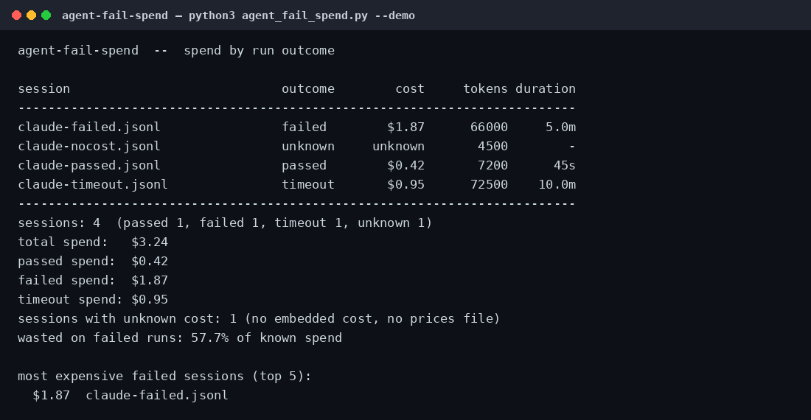

# agent-fail-spend



**Your coding agent spent $3.24 on four sessions. $1.87 of it died on runs that never passed. This tool shows you that split, session by session, in 0.06 seconds.**

It reads your Claude Code session transcripts (or any generic JSONL run log) and reports spend by run outcome: passed, failed, timeout, unknown. The headline is the wasted share. On the bundled synthetic fixtures, 57.7% of known spend went to failed runs. Those fixtures are labelled test data, not real spend, and the figure exists to show what the report looks like, not what your bill says.

## Why now

Runta published FrontierHarness Eval v1.1 on 2026-11-17, and it topped Hacker News on 2026-11-21. The study ran 27,280 coding-agent runs across 22 harnesses, 5 models, and 62 tasks, burning 83B tokens. Two findings matter here.

First, 64.5% of list-price cost went to trials that did not pass: 52.7% failures plus 11.8% timeouts. Second, 68–82% of failed runs ended with a confident final answer, not a timeout, and higher cost did not predict higher pass rates. The money is going somewhere, and the runs that eat it look finished when they fail.

Most developers only ever see one monthly total. That total hides the split. This tool makes the split visible, per session, from files already on your disk.

**Status 2026-11-24:** the agent toolchain is still the hottest theme on GitHub — today's Trending daily list is led by agent skills and plugins (Claude-BugHunter #1; cursor/plugins #5, +397 stars in a day), and the weekly #1 is an agent collaboration workbench. Every new agent that lands in a workflow adds sessions to somebody's bill, and none of them itemise the waste. Source: GitHub Trending, read 2026-11-24 14:08 CST (see the day's scout report for the full list).

Source: [Runta — Introducing FrontierHarness Eval](https://runta.com/blog/introducing-frontierharness-eval)

## Quick start (30 seconds)

```bash
git clone https://github.com/Mahgal/agent-fail-spend.git
cd agent-fail-spend
python3 agent_fail_spend.py --demo        # bundled synthetic fixtures
```

No pip installs, no dependencies, Python 3 only. Point it at your own transcripts:

```bash
python3 agent_fail_spend.py --dir ~/.claude/projects
python3 agent_fail_spend.py --file session.jsonl --json
python3 agent_fail_spend.py --dir ~/.claude/projects --prices examples/prices-example.json
python3 agent_fail_spend.py --format generic --file runs.jsonl
```

Verified from a clean copy (fresh copy in `/tmp`, 2026-11-24): `--demo` runs and the full test suite passes, 18/18, exit 0; the demo output is byte-identical to `demo.txt`. The demo runs in a median **0.0562 s** (7 runs, measured 2026-11-24 on this machine).

## Example output

Real output of `python3 agent_fail_spend.py --demo` (captured verbatim to `demo.txt`; re-runs reproduce it byte-for-byte, sha256 `9ec591d6ca3de11c98bd0f95ceff3188eb9877709a01900b1966765aecdbe9c2`):

```
agent-fail-spend  --  spend by run outcome

session                            outcome        cost     tokens duration
--------------------------------------------------------------------------
claude-failed.jsonl                failed        $1.87      66000     5.0m
claude-nocost.jsonl                unknown     unknown       4500        -
claude-passed.jsonl                passed        $0.42       7200      45s
claude-timeout.jsonl               timeout       $0.95      72500    10.0m
--------------------------------------------------------------------------
sessions: 4  (passed 1, failed 1, timeout 1, unknown 1)
total spend:   $3.24
passed spend:  $0.42
failed spend:  $1.87
timeout spend: $0.95
sessions with unknown cost: 1 (no embedded cost, no prices file)
wasted on failed runs: 57.7% of known spend

most expensive failed sessions (top 5):
  $1.87  claude-failed.jsonl
```

The top-5 list is the part you act on. One expensive failed session usually has a fixable cause: a prompt that loops, a test that never stabilises, a context window that fills up before the task does.

## How cost is decided

The tool prefers the cost your transcript already records. Claude Code `result` messages carry `total_cost_usd` when present, and that number wins. If a transcript has token usage but no embedded cost, the tool prices the tokens only from a `--prices` file you supply. `examples/prices-example.json` shows the format and is labelled as user-supplied list-price estimates. Model prices are never hard-coded in this tool, because list prices change and an unverifiable price would be an invented dollar. If neither source is available, the session reports its tokens and its cost reads `unknown`. Unknown is honest. A guessed dollar figure is not.

## Input formats

**Claude Code transcripts (default).** Reads `~/.claude/projects/*/*.jsonl`. A `result` message with subtype `success` counts as passed, subtype `error` as failed, and an error mentioning a timeout as timeout. Assistant messages contribute their token usage and model name. A transcript with no `result` message counts as unknown, since the outcome cannot be read from the file.

**Generic JSONL run logs (`--format generic`).** One object per line, with fields like `{"id": ..., "status": ..., "cost_usd": ...}` or `{"id": ..., "outcome": ..., "tokens": ..., "model": ...}`. Status synonyms are mapped as follows:

| outcome | accepted values |
|---|---|
| passed | pass, passed, success, succeeded, ok |
| failed | fail, failed, failure, error, errored |
| timeout | timeout, timed_out, timed-out, timedout |
| unknown | anything else, or missing |

## What it does not do

Outcome classification is a heuristic for transcripts without a `result` message. A session that ended without one reads as unknown, and that is the correct answer for a file that does not say how it ended. Prices are your estimates, so the dollar totals are only as good as the file you supply. The tool reads local files only. It makes no API calls and sends nothing anywhere. Malformed lines are skipped with a warning count, never a crash, and the exit code stays 0 whenever a report is produced, even when failed spend is greater than zero. The report is the product. Exit code 2 means a bad input path or unreadable files.

## Tests

```bash
python3 tests/run_tests.py   # 18 tests, stdlib only, exit 0
```

Coverage includes result-message parsing, usage aggregation across messages, outcome classification including synonyms, pricing math against the example prices file, malformed-line tolerance, an empty directory, missing-cost handling, demo determinism (two runs, identical sha256), and the hand-computed fixture totals asserted in `tests/run_tests.py`. The 2026-11-24 refresh added 5 tests: `duration_seconds` conversion in generic logs, `is_error` on a success subtype counting as failed, a timeout carried only in an error-dict message, duration-rendering boundaries (`-` / `45s` / `5.0m`), and a bad prices file exiting 2.

## License

MIT. See [LICENSE](LICENSE).
